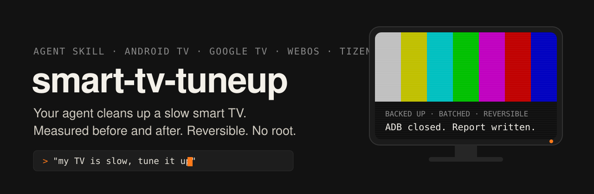
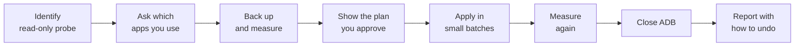

<p align="center">
  
</p>

<p align="center">
  <a href="LICENSE"></a>
  
  
  
</p>

An agent skill that tunes up a slow smart TV running Android TV, Google TV, LG webOS or Samsung Tizen.

Install it and tell your agent "my TV is slow, tune it up". The agent identifies the TV, backs it up, shows you a plan, cleans it in small batches, measures the result and leaves a way to undo every change. You only do what has to happen on the TV itself: turn on debugging, accept a prompt, press a button on the remote.

## Install

```bash
npx skills add Pacheche/smart-tv-tuneup -g -y
```

Or clone it into your agent's skills folder:

| Agent | Folder |
|---|---|
| Claude Code | `~/.claude/skills/smart-tv-tuneup` |
| Codex | `~/.codex/skills/smart-tv-tuneup` |
| Copilot CLI, Gemini CLI, others | `~/.agents/skills/smart-tv-tuneup` |

```bash
git clone https://github.com/Pacheche/smart-tv-tuneup.git ~/.claude/skills/smart-tv-tuneup
```

If your agent does not load skills, open this folder and ask it to follow `SKILL.md`. `AGENTS.md` already points there.

## Use

```text
My TV is slow, tune it up. Its IP is 192.168.1.50
```

The agent needs a terminal, Python 3, git and the same network as the TV.

## How it works



- **Identify.** A read-only TCP probe finds the platform. The agent records the exact model, firmware and fingerprint before changing anything.
- **Back up.** Packages, which app answers HOME, Wi-Fi owners, settings and baseline metrics after a reboot.
- **Apply.** `pm disable-user --user 0`, one command at a time, re-checked after each batch, with at least 45 s before any reboot. Never `pm uninstall`.
- **Measure.** The same metrics as the baseline, with model, context and units. No before and after, no claim of improvement.
- **Close.** ADB counts as closed only when the TV refuses the connection. A timeout does not count.

## What it covers

| Platform | What the skill does |
|---|---|
| Android TV, Google TV (no root) | Identify, back up, plan and apply a debloat over ADB with [cleanyourtv](https://github.com/Gathin23/cleanyourtv), swap the Home launcher, verify and revert |
| LG webOS (no root) | Install a launcher as an app through Developer Mode. The factory Home stays |
| LG webOS with root | A guide to the requirements and risks. The skill does not root the TV |
| Samsung Tizen (no root) | Install a launcher as an app through Developer Mode and `sdb`. Retail sets have no shell or `pm` |
| Older Samsung (Orsay), Fire TV, Roku, VIDAA | Not covered. The agent says so and changes nothing |

## What it will not do

- Root a TV, flash firmware or downgrade it.
- Replace the Home screen on LG or Samsung. There the launcher is installed as an app.
- Remove bloatware on webOS or Tizen without root.
- Jump to a factory reset. That is the last step of the recovery ladder, after a cold boot, a phone remote or USB keyboard, re-enabling from Settings and a logged restore, and the agent warns you first.

## Scripts

```bash
python3 scripts/detect_tv.py <tv-ip>
python3 scripts/fetch_cleanyourtv.py
python3 scripts/plan_android.py --list <cleanyourtv>/examples/<model>/debloat.txt --enabled enabled.txt --wifi dumpsys-wifi.txt --output batch.txt
python3 -I scripts/test_scripts.py
```

`enabled.txt` comes from `adb shell pm list packages -e --user 0` and `dumpsys-wifi.txt` from `adb shell dumpsys wifi`. On Windows, use `py` instead of `python3`.

## Risk

Disabling packages can leave a TV unable to boot. This skill exists to shrink that risk (identify, back up, plan, small batches, at least 45 s before rebooting, never touch the core), but the risk is real and it is yours. Use it only on TVs you own or are allowed to change. Read [`references/recovery.md`](references/recovery.md) before you start.

## Credits

- `CORE_RE` and `CORE_OK` in `scripts/plan_android.py` come from [cleanyourtv](https://github.com/Gathin23/cleanyourtv) (MIT), which the skill also uses to apply changes on Android.
- `FACTORY_RE` in `scripts/plan_android.py` comes from [free-my-tv](https://github.com/simbasjungles/free-my-tv) (MIT).

MIT licence, © 2026 Francisco Rivarola.
